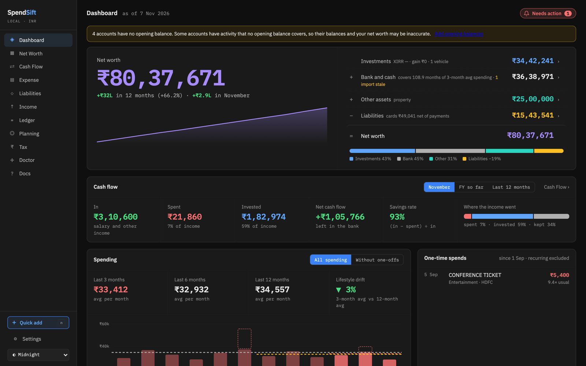
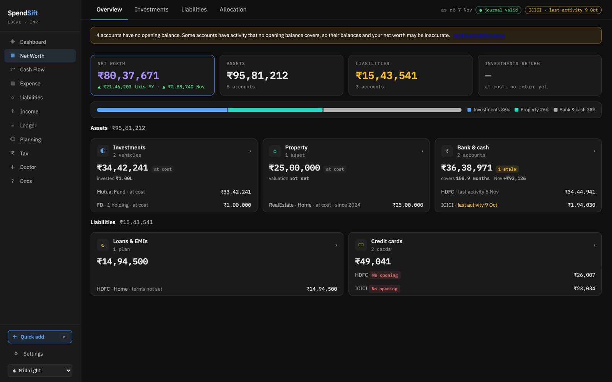
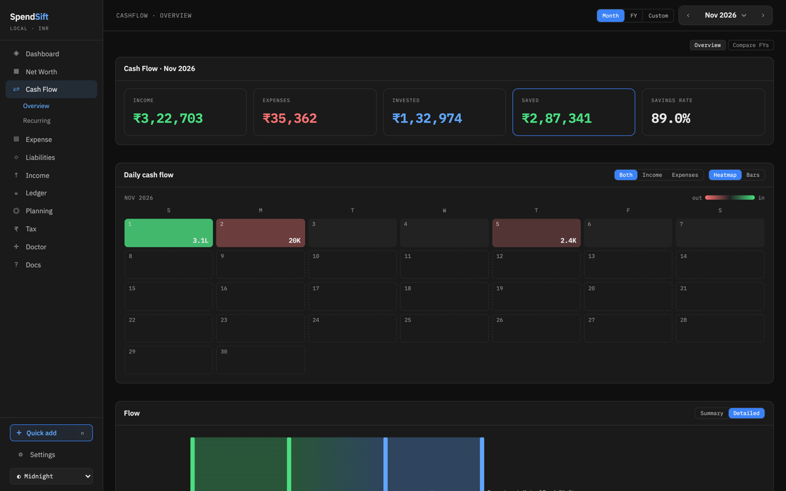
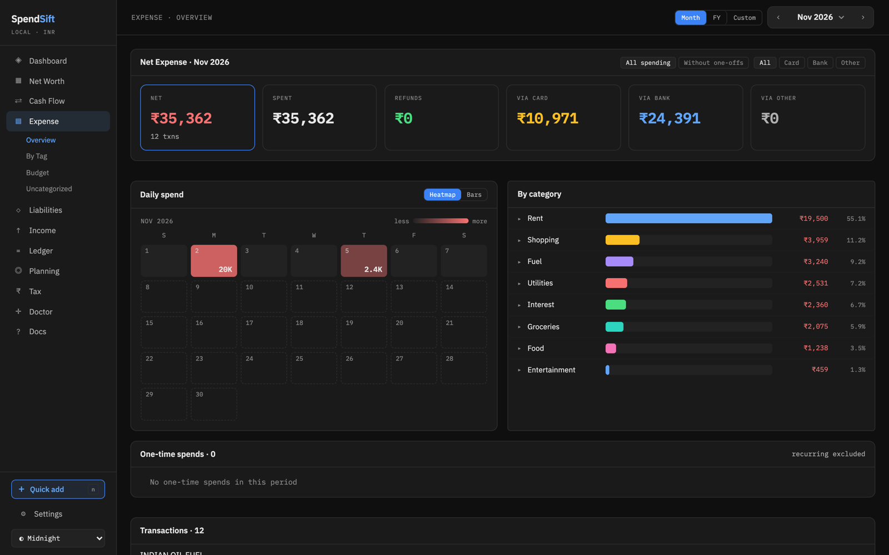
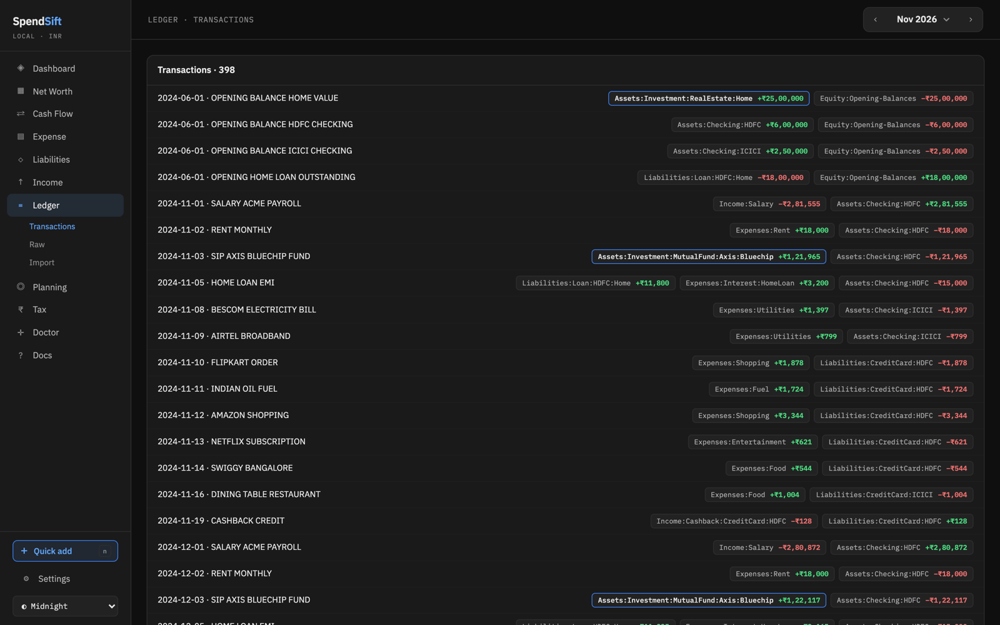

# SpendSift

**Local-first personal finance for India.** Drop in the statements your bank, card and broker already give you; SpendSift turns them into a trustworthy double-entry journal and a full set of dashboards — net worth, cash flow, expenses, liabilities, investments and tax — without a cloud account or manual bookkeeping.




> All screenshots use a fully synthetic demo ledger (`scripts/build_demo.py`). No real financial data is in this repository.

## Why

Personal finance tools usually force a trade-off: pretty dashboards that need constant manual entry, or powerful plain-text accounting that feels like bookkeeping. SpendSift keeps the plain-text journal as the source of truth and does the tedious part — parsing, deduplicating, matching transfers and categorizing — for you, while never importing anything it is unsure about without asking.

## Features

- **Statement ingestion** — CSV/XLS bank and card exports (HDFC, ICICI, IDFC, …), PDF credit-card statements, and Groww mutual-fund and stock order histories. Formats are fingerprinted and turned into reusable import templates; unknown layouts can be proven by an LLM agent and saved as templates.
- **Review before import** — every batch is staged; low-confidence rows, duplicates and possible transfers are surfaced for review, and nothing touches the journal until you commit.
- **Trustworthy writes** — the journal is [beancount](https://github.com/beancount/beancount); every write is snapshotted first and re-validated, so a balance error is a load error, not a silently wrong dashboard.
- **Deduplication & transfer matching** — card-bill payments, UPI-Lite top-ups and account-to-account moves are paired instead of double-counted.
- **Categorization that learns** — a merchant dictionary plus rules learned from your corrections; optional copy-paste LLM prompts for bulk categorization.
- **Investments** — mutual-fund cost lots (FIFO), historical NAV backfill from mfapi.in, stock prices, unrealized gains and XIRR.
- **Dashboards** — net worth over time, cash-flow sankey and daily heatmaps, expense by category/tag with budgets and one-off detection, loans/EMIs and credit cards.
- **Tax workspace** — Indian FY view: income buckets, capital gains (STCG/LTCG), declared deductions, old-vs-new regime comparison and prepaid-tax/TDS reconciliation.
- **Ledger tools** — transaction browser, raw journal editor (CodeMirror), quick add, ledger-cli/hledger journal import, and a "Doctor" that flags modelling defects such as negative asset balances.

| Net worth | Cash flow |
|---|---|
|  |  |
| **Expenses** | **Ledger** |
|  |  |

## Architecture

```
 statements (CSV / XLS / PDF)            React + TypeScript (Vite)
            │                                     │  typed client generated
            ▼                                     ▼  from the OpenAPI schema
 ┌──────────────────────── FastAPI on 127.0.0.1 ────────────────────────┐
 │ ingest: fingerprint → template → parse → normalize → dedup →         │
 │         transfer-match → review batch ──(approve)──► entry writer    │
 │ reports: cash flow · net worth · expense · liabilities · investments │
 │          · tax · health                                              │
 └───────────────────────────────┬──────────────────────────────────────┘
                                 ▼
          beancount journal (snapshotted) + YAML config / rules / templates
```

- **Local-first.** One loopback service, plain files on disk; no database, no account, no telemetry.
- **Contract-first.** Pydantic response models produce the OpenAPI schema; the frontend's API types are generated from it (`npm run gen:api`), so backend/frontend drift fails the build.
- **Coded errors.** Every failure carries a stable error code (`E10xx`) the UI and CLI can act on.
- **Read models.** Dashboards are computed from the journal by small report services in `backend/app/service/reports/`.

### Repo layout

| Path | What |
|---|---|
| `backend/app/server/` | FastAPI app factory and route modules |
| `backend/app/service/ingest/` | import pipeline: templates, parsers, normalize, dedup, transfer match, entry writer |
| `backend/app/service/reports/` | dashboard read models |
| `backend/app/service/tax/`, `investments/`, `categorize/` | domain services |
| `backend/app/persistence/` | beancount journal store, review batches, YAML stores |
| `backend/app/llm/` | template-proving flow and categorization prompts |
| `frontend/` | React 19 + TypeScript app (D3 charts, CodeMirror editor) |
| `scripts/` | demo builders, ingest CLI, migrations |
| `tests/` | pytest suites and synthetic statement fixtures |

## Quickstart

Requires Python 3.13+, [uv](https://docs.astral.sh/uv/) and Node 20+.

```bash
uv sync
scripts/run_demo.sh          # builds a synthetic demo ledger + the frontend, serves http://127.0.0.1:8766
```

To run against your own data (stored under `storage/`, gitignored):

```bash
scripts/run_app.sh           # builds the frontend if needed, serves http://127.0.0.1:8765
```

## Tests

```bash
uv run pytest -q             # ~4,300 backend tests
uv run ruff check .
cd frontend && npm test      # ~950 frontend tests
cd frontend && npm run lint  # ESLint
cd frontend && npm run build # type-check + production build
```

## Built with an agent workflow

Most of SpendSift was built with Claude Code driving a declarative "reconciliation loop": each unit of work has a desired-state spec, and dedicated agents (`architect`, `builder`, `critiq`, `code-reviewer`, defined in `.claude/agents/`) plan, implement and review it until every done-gate passes. The `/ingest-stmt` skill (`.claude/skills/ingest-stmt/`) lets an agent prove an import template for a new statement layout through the CLI without ever reading the statement itself. Project conventions for the agents live in `CLAUDE.md`.

## Docs

- [VISION.md](VISION.md), [PRODUCT.md](PRODUCT.md) — what and why
- [TRD.md](TRD.md), [SCHEMA.md](SCHEMA.md), [API_CONTRACT.md](API_CONTRACT.md) — design and contracts
- [RUNBOOK.md](RUNBOOK.md) — operating and verification commands
- [`docs/product/`](docs/product/) — per-screen and per-subsystem notes

## License

[MIT](LICENSE)
